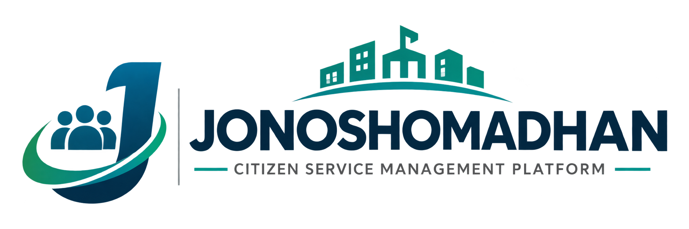
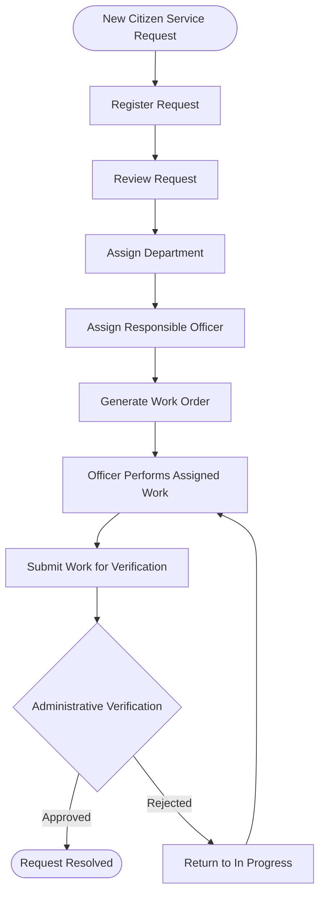
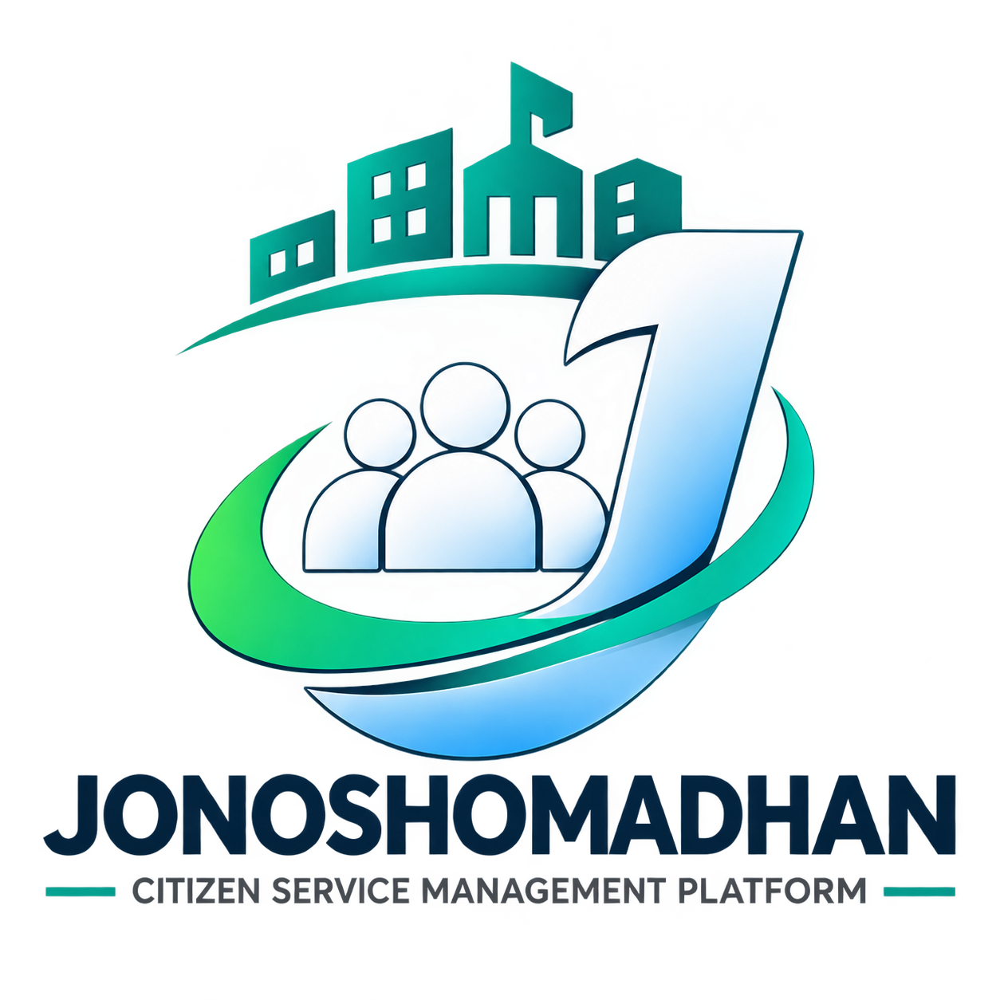

# 🏙️ JONOSHOMADHAN — জনসমাধান

<h3 align="center">A Civic Technology Platform for Smarter Public Service Management</h3>

<p align="center">
  <strong>নাগরিকের সমস্যা, সমাধানের অগ্রযাত্রা।</strong>
</p>

<p align="center">
  
</p>

<p align="center">
  
  
  
  
  
</p>

<p align="center">
  <a href="#-overview">Overview</a> •
  <a href="#-features">Features</a> •
  <a href="#-technology-stack">Technology</a> •
  <a href="#-installation--setup">Installation</a> •
  <a href="#-project-structure">Structure</a> •
  <a href="#-roadmap">Roadmap</a>
</p>

---

## 🌐 Overview

**Jonoshomadhan (জনসমাধান)** is a multi-city corporation citizen service request and work order management system designed to improve how public service complaints are recorded, assigned, monitored, and resolved.

The platform aims to establish a structured connection between citizens, city corporation departments, and responsible field officers through a centralized service management workflow.

From reporting infrastructure problems to tracking departmental work orders, Jonoshomadhan provides an organized approach to managing civic service requests.

The current implementation is a Python-based desktop prototype built with Tkinter and JSON file storage.

> **Our Vision:** Making public service management more organized, transparent, accessible, and accountable through technology.

## 🎯 Project Objectives

- Centralize citizen service requests from multiple city corporations.
- Organize complaints according to categories and departments.
- Improve departmental assignment and officer accountability.
- Monitor the progress of assigned service requests.
- Introduce work order management and completion verification.
- Generate meaningful operational reports and statistics.
- Establish a foundation for a scalable civic technology platform.

## ✨ Features

### 📊 Administrative Dashboard

- Overview of total service requests.
- Resolved and pending request statistics.
- Automatic resolution rate calculation.
- Organized service request register.
- Search and refresh functionality.

### 📝 Citizen Service Request Management

- Register new service requests.
- Generate unique request IDs.
- Record corporation, ward, category, location, and description.
- View request details.
- Edit existing requests.
- Delete requests with confirmation.
- Maintain persistent records using JSON storage.

### 🏢 Department & Officer Assignment

- Corporation-specific department selection.
- Assign service requests to responsible officers.
- Display assigned officer information.
- Manage departmental responsibilities.

### 📋 Work Order Management

- Generate work orders for assigned requests.
- Monitor operational progress.
- Update work order statuses.
- Submit completed work for verification.
- Approve or reject completion with verification notes.
- Synchronize work order verification with complaint status.

### 📈 Analytics & Reporting

- Generate service request summaries.
- Analyze request status distribution.
- Review category-wise statistics.
- Review department-wise statistics.
- Calculate resolution percentages.
- Export service request records to CSV.

## 🖥️ Application Preview

### Main Administrative Dashboard

<p align="center">
  

</p>


### Work Order Management

<p align="center">
  

</p>


## 🛠️ Technology Stack

| Technology | Purpose |
|---|---|
| Python | Core application logic |
| Tkinter | Desktop graphical user interface |
| JSON | Data persistence and storage |
| CSV | Report export |
| Git | Version control |
| GitHub | Source code hosting |

**Development approach:** Object-Oriented Programming (OOP), modular architecture, file handling, exception handling, and data validation.

**Dependencies:** Python standard library only. No third-party packages are currently required.

## 🏗️ System Modules

| Module | Responsibility |
|---|---|
| `main.py` | Application entry point |
| `interface.py` | Graphical user interface |
| `models.py` | Community issue data model |
| `issue_manager.py` | Service request operations |
| `officer_manager.py` | Officer management |
| `work_order_manager.py` | Work order operations |
| `report_manager.py` | Analytics and CSV reporting |
| `storage.py` | JSON file storage management |

## 📁 Project Structure

```text
Jonoshomadhan/
│
├── assets/
│   ├── jonoshomadhan_logo.png
│   └── jonoshomadhan_icon.png
│
├── data/
│   ├── corporations.json
│   ├── departments.json
│   ├── issues.json
│   ├── officers.json
│   └── work_orders.json
│
├── main.py
├── interface.py
├── models.py
├── issue_manager.py
├── officer_manager.py
├── work_order_manager.py
├── report_manager.py
├── storage.py
│
├── README.md
└── .gitignore
```

## ⚙️ Installation & Setup

Follow these instructions to run Jonoshomadhan locally.

### 1. Prerequisites

Install:

- Python 3.10 or later.
- Git.
- Visual Studio Code (recommended).

Make sure Tkinter is available in your Python installation.

### 2. Clone the Repository

```bash
git clone https://github.com/MominurIslamRoby/Jonoshomadhan.git
```

### 3. Navigate to the Project Directory

```bash
cd Jonoshomadhan
```

### 4. Create a Virtual Environment

```bash
python -m venv .venv
```

### 5. Activate the Virtual Environment

**Windows PowerShell:**

```powershell
.venv\Scripts\Activate.ps1
```

**Windows Command Prompt:**

```cmd
.venv\Scripts\activate.bat
```

### 6. Run the Application

```bash
python main.py
```

The Jonoshomadhan administrative desktop application should now launch.

## 🔄 Service Request Workflow



## 🗃️ Data Management

Jonoshomadhan currently uses JSON files for local data persistence.

| File | Description |
|---|---|
| `corporations.json` | City corporation records |
| `departments.json` | Department information |
| `issues.json` | Citizen service requests |
| `officers.json` | Officer information |
| `work_orders.json` | Work order records |

The application loads existing records when initialized and saves changes to the corresponding JSON files.

## 🔐 Project Scope & Disclaimer

Jonoshomadhan is an independently developed academic software prototype.

- The corporation and operational records currently included are sample data.
- This project is not an officially endorsed or deployed system of any Bangladesh City Corporation.
- It does not currently connect to government databases or official services.
- The current version uses local JSON storage and is intended for demonstration and educational purposes.

## 🚀 Roadmap

The following improvements are potential future development goals:

- [ ] Citizen-facing web portal.
- [ ] Responsive mobile application.
- [ ] Citizen registration and authentication.
- [ ] Online service request submission.
- [ ] Real-time request tracking.
- [ ] Interactive geographical complaint mapping.
- [ ] Role-based access control.
- [ ] Advanced notification system.
- [ ] Cloud-based database integration.
- [ ] Multi-city corporation administration.
- [ ] Advanced analytics and reporting.
- [ ] Bangla and English language support.

## 🎓 Academic Project Information

**Project Name:** Jonoshomadhan — জনসমাধান

**Project Category:** Civic Technology / Information System

**Current Application Type:** Desktop Management Software

**Programming Language:** Python

**Course:** Programming in Python

**Institution:** American International University-Bangladesh

**Project Purpose:** Academic midterm project and prototype development.

## 👨‍💻 Developer

<p align="center">
  <strong>Mominur Islam Roby</strong><br>
  Student Developer | Python & Software Development
</p>

<p align="center">
  <a href="https://github.com/MominurIslamRoby">
    
  </a>
  <a href="https://github.com/MominurIslamRoby/Jonoshomadhan">
    
  </a>
</p>

---

<p align="center">
  
</p>

<h3 align="center">জনসমাধান | JONOSHOMADHAN</h3>

<p align="center">
  <strong>Building a smarter approach to citizen service management.</strong>
</p>

<p align="center">
  Made with ❤️ in Bangladesh 🇧🇩
</p>
